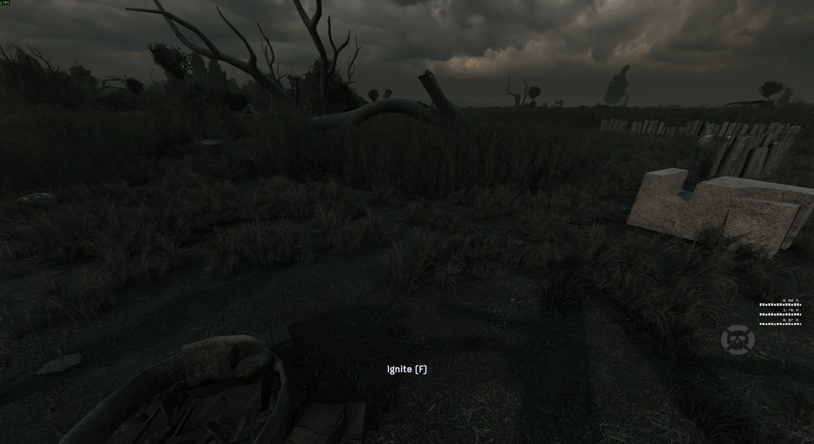

# Unholy's Battery-Free Equipment Mod

Run headlamps, PDAs, detectors, and night vision without carrying spare batteries. In supported modpacks, the same rules apply to thermal sights, weapon lights, exoskeletons, and battery-powered hideout lamps.



*The Great Swamps in Romeo. This session verified that an equipped headlamp turned on and its charge held through a scripted drain attempt.*

## Compatibility

| Game | Coverage | Verification |
| --- | --- | --- |
| Anomaly 1.5.3 | Stock battery-powered equipment and supplies | Build and Lua syntax checked |
| GAMMA | Stock equipment plus the profile's 3DSS thermal sights, exoskeletons, and hideout lights | Build and Lua syntax checked against the tested MO2 profile |
| Romeo | GAMMA coverage plus supported wearable devices and weapon lights | Build and Lua syntax checked. Headlamp behavior verified in game |

Install the ZIP generated for your own game or MO2 profile. It contains the patched local game files, so it inherits the device integrations enabled in that profile. Keep the same mod build on each Romeo co-op PC.

## Build the installable ZIP

Download this repository using **Code → Download ZIP** and extract it. The builder uses Python 3.9 or newer and the files already installed with your game.

1. Run `db_unpacker.bat` from Anomaly's `tools` folder. This extracts the stock `configs` and `scripts` into `tools/_unpacked`.
2. Open PowerShell in the extracted repository. Replace the sample paths with your own and use a new output ZIP filename.

   **Standalone Anomaly**

   ```powershell
   py -3 .\package.py "Battery-Free Equipment.zip" --anomaly "D:\Games\Anomaly" --vanilla "D:\Games\Anomaly\tools\_unpacked"
   ```

   **GAMMA or Romeo**

   ```powershell
   py -3 .\package.py "Battery-Free Equipment.zip" --anomaly "D:\Games\Anomaly" --vanilla "D:\Games\Anomaly\tools\_unpacked" --mo2 "D:\Games\GAMMA" --profile "G.A.M.M.A"
   ```

   `--mo2` points to the base folder with `mods` and `profiles`. For Romeo, use your active Romeo profile name from the MO2 dropdown. If a previous build is enabled under a custom name, pass `--exclude-mod "Previous Mod Name"`.

3. Install the generated ZIP in MO2 with higher priority than its source mods. For standalone Anomaly, use a mod manager or merge the generated `gamedata` folder into your game directory. Restart the game after installing. Rebuild the ZIP after changing source mods or profiles.

## Saves and equipment

- New normal trader supplies, loot, crafting, and fetch tasks omit the regular and exoskeleton battery items. A saved dynamic battery fetch task switches to copper parts with the same quantity.
- Batteries already placed or carried can remain in existing saves. Their item definitions are retained for save compatibility.
- Exoskeleton power supply upgrades still unlock their special abilities. Non-battery fuel and battery-themed artefacts retain their original behavior.
